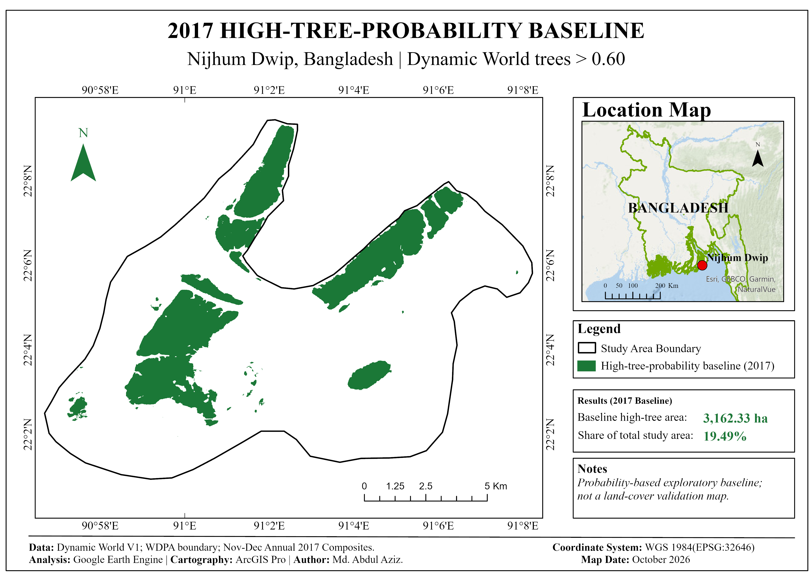
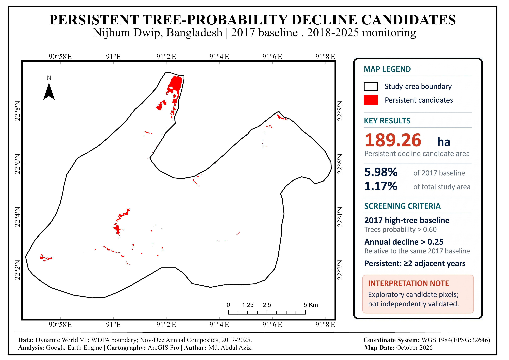

# Nijhum Dwip | Persistent Tree-Probability Decline (2017–2025)

**An exploratory remote-sensing study using Dynamic World class probabilities, Google Earth Engine, and Sentinel-2.**

**Study area:** Nijhum Dwip, Bangladesh · **Status:** Exploratory / work in progress · **Analysis:** Google Earth Engine (JavaScript) · **Cartography:** ArcGIS Pro

> **Interpretation note:** The mapped areas are *tree-probability decline candidates*, **not** independently verified deforestation, forest loss, or disturbance events. This project is inspired by Li, Ota, and Mizoue (2024), but **does not reproduce their complete disturbance-attribution or validation framework**.

## Overview

Can annual Dynamic World *trees* probability composites help identify locations showing sustained decline relative to an earlier high-tree-probability baseline? This repository documents a transparent, threshold-based screening workflow for Nijhum Dwip, a dynamic coastal landscape in Bangladesh.

The analysis first identifies high-tree-probability pixels in **2017**, then checks **2018–2025** for substantial declines relative to that *same* baseline. Supporting class-probability trajectories and Sentinel-2 spectral indices are examined to inform interpretation. The work is a methodological exploration rather than a validated change inventory.

## Research figures

### Figure 1 · High-tree-probability baseline (2017)



*November–December 2017 Dynamic World median composite; baseline defined as `trees > 0.60`. The screening mask covers **3,162.33 ha (19.49% of the study area)**. It is not a validated forest-cover map.*

### Figure 2 · Persistent tree-probability decline candidates (2018–2025)



*Pixels from the 2017 baseline showing a decline of **more than 0.25** in Dynamic World `trees` probability in **at least two adjacent years** during 2018–2025, each assessed relative to 2017. The mapped persistent candidate area is **189.26 ha**.*

## Key results

| Metric | Estimate |
|:--|--:|
| Study-area extent (WDPA AOI) | 16,229.24 ha |
| 2017 high-tree-probability baseline | **3,162.33 ha** |
| Baseline as a share of the study area | 19.49% |
| Candidate decline in at least one monitoring year | 302.63 ha |
| Candidate decline as a share of the 2017 baseline | 9.57% |
| **Persistent decline candidates (≥2 adjacent years)** | **189.26 ha** |
| Persistent candidates as a share of the 2017 baseline | **5.98%** |
| Persistent candidates as a share of the study area | 1.17% |

These are area estimates for *probability-based screening masks*, calculated using the current GEE workflow—not independently measured areas of tree removal.

[Download the underlying numerical summary (CSV)](results/area_summary.csv)

## Methods at a glance

| Stage | Implementation |
|:--|:--|
| **1. Study-area boundary** | WDPA polygon filtered by `SITE_ID = 317318` |
| **2. Annual probabilities** | Median of the nine Dynamic World class-probability bands for each **November–December**, 2016–2025 |
| **3. Baseline screen** | 2017 `trees` probability **> 0.60** |
| **4. Annual decline** | `2017 trees probability − current-year trees probability > 0.25` |
| **5. Any-year candidate** | A baseline pixel exceeding the decline threshold in at least one year, 2018–2025 |
| **6. Persistent candidate** | A baseline pixel exceeding that threshold in **two or more consecutive years**, each compared with 2017 |
| **7. Supporting diagnostics** | Class-probability trajectories; Sentinel-2 NDVI and MNDWI; candidate-point and candidate-area summaries |
| **8. Sensitivity and QC** | Decline thresholds **0.20 / 0.25 / 0.30**; baseline thresholds **0.55 / 0.60 / 0.65**; area consistency checks |

**Important distinction:** “Persistent” does **not** require the tree probability to decrease monotonically every year. It means the baseline-relative decline criterion is met in at least one pair of consecutive monitoring years.

### Datasets and processing

- **Dynamic World V1:** `GOOGLE/DYNAMICWORLD/V1` — nine land-cover class-probability bands.
- **Study-area boundary:** `WCMC/WDPA/current/polygons` — WDPA feature with `SITE_ID = 317318`.
- **Sentinel-2 Surface Reflectance Harmonized:** `COPERNICUS/S2_SR_HARMONIZED` — spectral context and NDVI/MNDWI diagnostics.
- **Cloud Score+:** `GOOGLE/CLOUD_SCORE_PLUS/V1/S2_HARMONIZED` — Sentinel-2 diagnostic composites use `cs_cdf >= 0.60`.

Dynamic World annual composites are restricted to **November–December**. Sentinel-2 diagnostics cover **2017–2025**, with selected closer inspections of **2023–2025**. Availability of source scenes is checked in the script; it should not be confused with a complete independent assessment of cloud-free pixel coverage.

## Repository contents

```text
.
├── README.md
├── scripts/
│   └── Nijhum_TreeProbability_Decline_Main.js
├── figures/
│   ├── Fig01_Nijhum_2017_High_Tree_Baseline.png
│   └── Fig02_Nijhum_Persistent_Tree_Decline_Candidates.png
└── results/
    └── area_summary.csv
```

- **[Main GEE analysis script](scripts/Nijhum_TreeProbability_Decline_Main.js)** — baseline construction, annual screening, persistence tests, temporal diagnostics, sensitivity analysis, QC, and map exports.
- **[Figure 1](figures/Fig01_Nijhum_2017_High_Tree_Baseline.png)** and **[Figure 2](figures/Fig02_Nijhum_Persistent_Tree_Decline_Candidates.png)** — GIS layouts prepared in ArcGIS Pro from the GEE-derived outputs.
- **[Area summary](results/area_summary.csv)** — numerical results reported above.

## How to run the analysis

1. **[Open the analysis directly in Google Earth Engine](https://code.earthengine.google.com/cd61b222b9b34522654bba02cff97f8d)** (Earth Engine access required). This is a **shared code snapshot**; it does not automatically track later edits.
2. Alternatively, open the **[versioned JavaScript source in this repository](scripts/Nijhum_TreeProbability_Decline_Main.js)** and copy it into your own [GEE Code Editor](https://code.earthengine.google.com/). Review the study-area selection, years, and thresholds before running.
3. Run the script and inspect the **Console** outputs, annual source-image counts, map layers, charts, sensitivity summaries, and area-QC differences.
4. If needed, run the two `Export.image.toDrive` tasks from the **Tasks** tab. The figures in this repository are the separately composed **ArcGIS Pro layouts**, not raw GEE exports.

The analysis uses public Earth Engine collections but can be affected by dataset revisions, collection availability, computation settings, and future changes in the study-area boundary. Reported results are a documented exploratory run, not a guarantee of identical outputs under every future rerun.

## Quality control and limitations

**Checks included:** annual input-image counts; area totals by candidate category and diagnostic year; alternative tree-decline thresholds; alternative baseline thresholds; and agreement checks comparing the main analysis with equivalent `T25` and `B60` sensitivity settings.

**Limitations to address before research publication:**

1. **No independent reference-data validation** has established the accuracy of the mapped candidate pixels or identified specific disturbance causes.
2. **Probability is not confirmed land cover.** Changes in the Dynamic World `trees` probability do not, by themselves, demonstrate deforestation.
3. **Coastal conditions matter.** Tides, water-level changes, seasonal vegetation conditions, mixed pixels, and changing shorelines may affect apparent patterns.
4. **Seasonal observation coverage and threshold dependence** require further assessment, including usable pixel-level observations across years.
5. **Sentinel-2 is supporting evidence, not independent validation:** Dynamic World itself is derived from Sentinel-2 imagery.
6. **Disturbance-type attribution is not established.** Changes in other class probabilities are exploratory transition indicators, not causal labels.

The next research steps are independent reference sampling and accuracy assessment, stronger observation-quality and tidal-context checks, and further sensitivity analysis.

## Research inspiration and citation

This study was inspired by the probability time-series approach introduced in:

> Li, Z., Ota, T., & Mizoue, N. (2024). **Attribution of forest disturbance types based on the Dynamic World class probability data: A case study of Myanmar.** *International Journal of Applied Earth Observation and Geoinformation, 134*, 104216. https://doi.org/10.1016/j.jag.2024.104216

**Relationship to the cited study:** The present repository explores a simplified, baseline-relative persistent-decline screen for Nijhum Dwip. It does **not** implement the full subseries-based disturbance classification or independently validated attribution reported by Li and colleagues.

## Author

**Md. Abdul Aziz**  
Remote Sensing · GIS · Google Earth Engine · Geospatial Analysis  
[GitHub profile](https://github.com/maamg)

---

*Research status: Exploratory / work in progress · Prepared October 2026*
